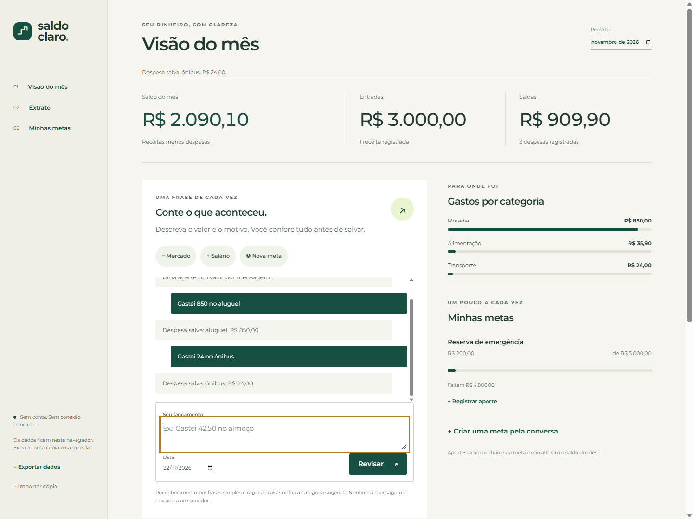

# Saldo Claro

Um organizador financeiro por conversa. Registro entradas, gastos e metas com frases curtas, confiro a proposta e só então salvo. Os dados ficam no navegador, sem conta ou conexão bancária.



## Executar

Requer Python 3 para servir os arquivos, ou outro servidor estático. Não há dependências de execução para instalar.

```sh
python -m http.server 8766 --bind 127.0.0.1
```

Abra [o aplicativo local](http://127.0.0.1:8766). Execute o comando na raiz deste repositório. Evite abrir o HTML diretamente por `file://`, pois os módulos JavaScript precisam de um servidor.

## Usar

1. Digite uma ação e um valor: `Gastei 35,90 no mercado`, `Recebi 3.000 de salário` ou `Criar meta Viagem de R$ 1.200`.
2. Confira descrição, data, valor e categoria. Confirme para gravar ou cancele para preservar os dados.
3. Acompanhe o saldo do mês, as despesas por categoria e o extrato. Filtre receitas ou despesas.
4. Registre aportes nas metas. Eles acompanham o objetivo separadamente e não são somados novamente ao extrato.
5. Exporte uma cópia JSON. Para importar, confira a prévia e confirme a substituição dos dados locais.

O interpretador usa regras locais para os padrões documentados. Não é um chat de propósito geral. Valores usam notação brasileira: `1.234,56`; mensagens com vários valores são recusadas para evitar um registro ambíguo. A categoria é uma sugestão editável.

## Especificação e evolução

- [PRD e instrução final de implementação](docs/PRD.md)
- [Registro de iterações, resultados e reflexão](docs/iteracoes.md)
- [Validação executada e limites](docs/validacao.md)
- [Revisão de meta no celular](docs/mobile-revisao.png)

Todas as capturas contêm dados fictícios do próprio aplicativo. Não representam finanças reais ou resultados de clientes.

## Verificar

Node.js 22 ou superior, sem pacotes externos:

```sh
npm test
npm run check
```

Os testes cobrem moeda e limites, propostas sem gravação, rejeição de ambiguidade, datas reais, confirmação duplicada, metas, totais por mês, aportes, importação e erro de armazenamento. Os fluxos da interface também foram conferidos no navegador; detalhes em `docs/validacao.md`.

## Dados e limites

- Armazenamento `localStorage`, até 1.000 lançamentos e 50 metas. Uma cópia importada substitui o estado inteiro após confirmação; não faz mesclagem.
- Não há criptografia, autenticação, sincronização ou integração bancária. Pessoas com acesso ao mesmo perfil do navegador podem ler os dados. Limpeza do navegador pode apagá-los.
- Use uma aba por vez. Mudança detectada em outra aba bloqueia novas alterações até recarregar; não é uma transação distribuída ou garantia contra toda concorrência.
- O histórico da conversa é temporário e reinicia ao recarregar; lançamentos e metas permanecem. Não informe senhas ou dados bancários na conversa.
- O resumo é contábil simples. Não oferece recomendações de investimentos, crédito ou promessa de economia.
- Testes manuais de teclado, rótulos, desktop, mobile e movimento reduzido não equivalem a auditoria completa com tecnologias assistivas.

## Estrutura

`core.js` concentra validação e cálculos puros; `app.js` cuida da interface e da persistência; `tests/` contém testes do domínio; `docs/` guarda especificação e evidências próprias. Nenhuma biblioteca externa é carregada durante o uso.

Código próprio sob [MIT](LICENSE). Montserrat distribuída sob [SIL Open Font License](assets/OFL-Montserrat.txt), com atribuição preservada.
