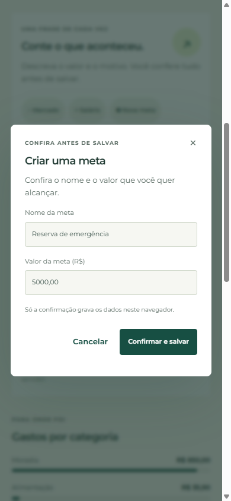
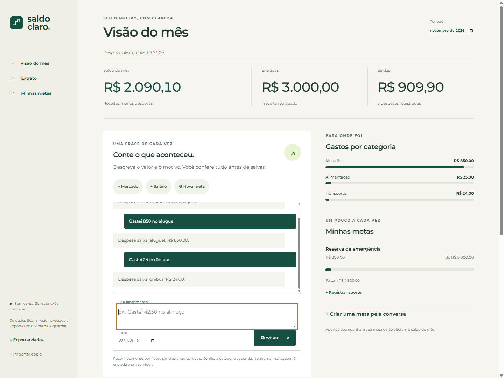

# Iterações e reflexão

## 1. Especificação

A ideia inicial de “registrar por conversa” foi delimitada com exemplos, confirmação antes de salvar e cinco funções verificáveis. A escolha foi um aplicativo local com reconhecimento por regras; ele não promete compreender qualquer frase. Essa restrição torna observável o que é aceito e mantém o funcionamento sem serviços externos.

## 2. Conferir a operação, não só a resposta

Na implementação, criar uma meta precisa alterar o estado real e o componente de metas. O teste confirmou `Reserva de emergência`, objetivo de R$ 5.000 e aporte de R$ 200, sem mudar o saldo do extrato. Recarregar preservou a meta. O cancelamento de outra proposta deixou o JSON anterior idêntico.

## 3. Testar os limites

`Gastei 20 e 30 no mercado` foi recusado. Texto semelhante a HTML apareceu literalmente, sem criar uma imagem ou executar um manipulador. Uma importação com valor inválido foi recusada; o arquivo exportado pelo próprio aplicativo foi importado com estado idêntico. Esses casos são observações específicas, não uma certificação de segurança.

## 4. Revisão visual

A primeira composição mobile fez os três totais ultrapassarem a largura disponível. A revisão coloca o saldo na primeira linha e entradas/saídas abaixo. Um rótulo oculto do extrato também escapava de seu contêiner; foi ancorado dentro dele. A medição final confirmou largura de documento e área útil iguais a 375 px. A fonte local carregou e o diálogo coube no celular com movimento reduzido ativado.

## Reflexão

O que funcionou foi converter intenções vagas em critérios concretos: “salvar depois de confirmar”, “aporte não muda o extrato” e “recusar arquivo inteiro quando houver registro inválido”. O que não funcionou inicialmente foi a distribuição dos totais em uma tela estreita; a captura e a medição revelaram isso antes da entrega.

O processo reforçou a necessidade de instruções claras, exemplos e revisão de resultados. Uma interface convincente não comprova persistência; uma resposta de confirmação não comprova que a operação aconteceu. A validação deve consultar o estado e o resultado observável. Não houve teste com usuários reais nem integração de produção.
